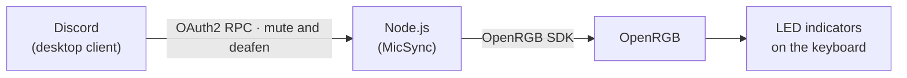
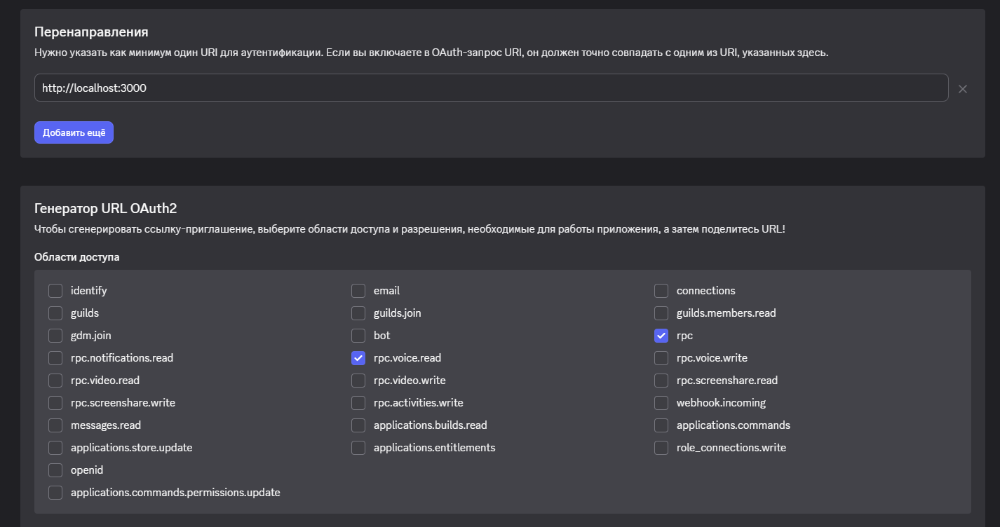
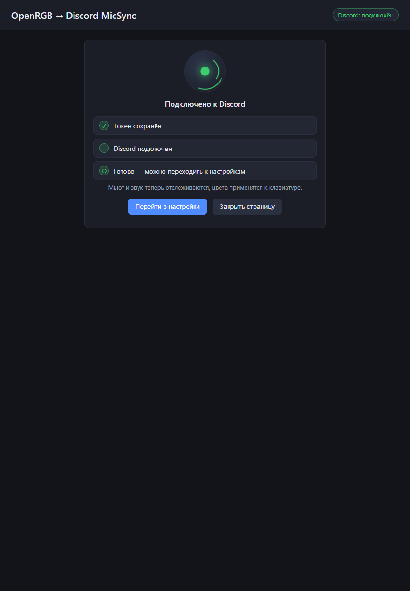
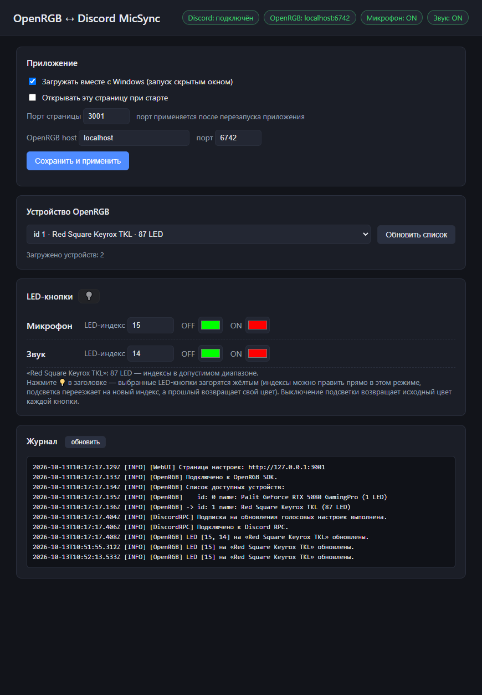

# OpenRGB ↔ Discord MicSync


[Русский](README.md) | **EN**

This application lights up your keyboard through **OpenRGB** in response to **microphone mute and sound deafen in Discord**. Two LED indicators on the keyboard show your voice state, so you can see when you are muted without leaving the game.



The status is read from **Discord**, not from Windows system settings: muting in Discord lights the indicator no matter where you triggered it.

---

## Features

- Microphone mute and sound deafen indicators sourced from Discord (Discord status, not the OS)
- Web settings page: device, LED indices, colors, autostart — no file editing
- Highlight mode 💡 — forces the selected LED buttons to glow yellow so you can find them on the keyboard
- Windows autostart (runs hidden)
- Automatic reconnection to Discord and OpenRGB with backoff, token refresh
- Event log on the settings page and in `logs/`

---

## Requirements

| Component | Purpose |
|---|---|
| Windows 10/11 | Runtime platform, autostart |
| [Node.js](https://nodejs.org/) 18 or newer | Running the application |
| [OpenRGB](https://openrgb.org/) with **SDK Server** enabled | Lighting control (default `localhost:6742`) |
| Running Discord desktop client | Source of the mute and deafen status |
| An application in the [Discord Developer Portal](https://discord.com/developers/applications) | OAuth2 authorization |

---

## Quick start

### 1. Install

```bash
git clone https://github.com/Neogara/OpenRGB-Discord-MicSync.git
cd OpenRGB-Discord-MicSync
npm install
```

### 2. Create the Discord application

1. Open the [Discord Developer Portal](https://discord.com/developers/applications) → **New Application**.
2. On the **OAuth2** page, copy the **Client ID** and **Client Secret**.
3. In the **Redirects** block, add the URL that exactly matches the string in `config.js`:

   ```
   http://localhost:3000
   ```

   > Port `3000` is reserved for the OAuth2 callback and cannot be changed in code. Discord rejects the authorization if the URL differs.

4. Below, in the **OAuth2 URL Generator** block → **Scopes**, tick exactly two scopes:

   - `rpc`
   - `rpc.voice.read`

   

   > **This is required.** Without `rpc` and `rpc.voice.read` ticked, Discord grants no access to the voice calls — the authorization will succeed, but nothing will be able to read mute and deafen. No other scopes are needed.

5. Create a `secrets.env` file in the project root:

   ```bash
   CLIENT_ID=your_client_id
   CLIENT_SECRET=your_client_secret
   ```

### 3. Enable the SDK Server in OpenRGB

Launch OpenRGB → **Settings** → **General** tab → check **Enable SDK Server** → **Apply**. Keep `localhost` and `6742`.

### 4. First run

```bash
npm start
```

On the first run a browser opens for Discord authorization. Grant access — once connected, you will see the result screen:



Click **«Перейти в настройки»** (*Go to settings*) to open the settings page. Its address is printed to the log on every start:

```
[WebUI] Страница настроек: http://127.0.0.1:3001
```

Later runs need no authorization: the application stores the token and refreshes it automatically.

---

## Settings page

The page is served on `127.0.0.1` and is reachable only from your machine. The address and port are printed to the log; the port can be changed on the page itself.



The page has four blocks:

| Block | What it configures |
|---|---|
| **Приложение** (Application) | Autostart, open page on start, page port, OpenRGB host and port |
| **Устройство OpenRGB** (Device) | Device selection from the live list OpenRGB reports |
| **LED-кнопки** (LED buttons) | LED indices for microphone and sound, OFF/ON colors per channel |
| **Журнал** (Log) | Recent application events with a refresh button |

The header shows status badges:

| Badge | Meaning |
|---|---|
| `Discord: подключён` (connected) | The application sees Discord and subscribes to voice events |
| `OpenRGB: localhost:6742` | Connection to the SDK Server is established |
| `Микрофон: OFF` / `ON` | **OFF** — muted (red), **ON** — unmuted (green) |
| `Звук: OFF` / `ON` | **OFF** — deafened (red), **ON** — sound on (green) |

### The highlight button 💡

The button in the «LED-кнопки» header is a toggle. When enabled, the selected LED indices glow yellow: it makes it easy to locate the right keys on the keyboard and verify the indices are correct. You can edit the indices while the mode is on — the highlight moves to the new index and the previous one returns to its own color. Turning the highlight off restores the color that was lit before.

### What applies immediately and what needs a restart

| Change | When it applies |
|---|---|
| Device, LED indices, colors, OpenRGB host and port | Immediately after «Сохранить и применить» (Save and apply) |
| Autostart, open page on start | Immediately |
| Settings page port | After restarting the application |

---

## Configuration

The application splits settings into three layers:

| Layer | File | Purpose |
|---|---|---|
| User settings | `settings.json` | Device, LED indices, colors, ports, autostart. Created and edited on the settings page |
| Infrastructure constants | `config.js` | OAuth2 credentials, callback URL, token file. Edit only when you change the application in the Developer Portal |
| Environment variables | `secrets.env` | `CLIENT_ID` and `CLIENT_SECRET`. Take priority over the other sources |

`settings.json` is created automatically on the first save. Until then, defaults from `settings.js` are used:

| Parameter | Default |
|---|---|
| `device.keyboardDeviceId` | `1` |
| `device.micLedIndex` | `15` |
| `device.soundLedIndex` | `14` |
| `colors.micMuted` (OFF) | `#00FF00` — green |
| `colors.micUnmuted` (ON) | `#FF0000` — red |
| `colors.soundDeaf` (OFF) | `#00FF00` — green |
| `colors.soundUndeaf` (ON) | `#FF0000` — red |
| `openrgb.host` / `openrgb.port` | `localhost` / `6742` |
| `webui.port` / `webui.openOnStart` | `3001` / `false` |
| `autostart` | `false` |

The LED OFF/ON colors are configured separately from the header badge colors.

### Environment variables

| Variable | Purpose |
|---|---|
| `CLIENT_ID`, `CLIENT_SECRET` | OAuth2 credentials (usually from `secrets.env`) |
| `DISCORD_PIPE` | Discord pipe name, e.g. `discord-ipc-5` for Canary. Empty — automatic scan of `discord-ipc-0..9` |
| `OPENRGB_HOST`, `OPENRGB_PORT` | Override the OpenRGB address (for tests and non-standard setups) |

---

## Troubleshooting

The log is available in the **«Журнал»** block on the settings page and in `logs/app-<date>.log`. Files rotate at 5 MB.

| Symptom | Likely cause | Fix |
|---|---|---|
| `Discord: нет (…)`, badge never changes | Discord is not running or authorization was not completed | Start Discord. If the token expired or was deleted — restart the application and the browser will open the authorization flow again |
| Discord runs Canary/PTR | Different IPC pipe | Set `DISCORD_PIPE` (e.g. `discord-ipc-5`) |
| Discord connects but mute is not tracked | The `rpc` and `rpc.voice.read` scopes are not ticked in the Developer Portal | Open your app in the [Developer Portal](https://discord.com/developers/applications) → **OAuth2** → **OAuth2 URL Generator** → **Scopes**, tick `rpc` and `rpc.voice.read`, then delete `discord_token.json` and restart the application to re-authorize |
| `OpenRGB: не подключён` (not connected) | SDK Server is off or the port differs | Enable **Enable SDK Server** in OpenRGB and check the host/port on the settings page |
| The wrong keys light up | Wrong LED index | Turn on 💡 and adjust the index until the key glows yellow |
| Settings page does not open | The port is taken by another app | The port is printed to the log on start. Set another one in the «Приложение» block and restart the application |
| Authorization ends with an error | Redirect in the Developer Portal does not match | The **Redirects** field must contain exactly `http://localhost:3000` — no `127.0.0.1`, no trailing slash |
| Settings reset | Invalid values in `settings.json` | Values fall back to defaults and the reason is written to the log. Open the settings page and save them again |

---

## Project structure

```
OpenRGB-Discord-MicSync/
├── main.js                Entry point
├── config.js              Constants: OAuth2, ports, files
├── settings.js            Loading, validating and saving settings.json
├── tokenManager.js        OAuth2 authorization and token refresh
├── discordIpc.js          Discord IPC client (named pipes)
├── discordRpc.js          RPC layer: voice subscriptions, reconnection
├── openRGBController.js   OpenRGB connection, color application, highlight
├── autostart.js           Windows autostart (.vbs in the Startup folder)
├── logger.js              Logging to console and logs/
├── webui/
│   ├── server.js          HTTP server for the settings page and API
│   └── public/            Markup, styles and scripts
├── docs/screenshots/      Screenshots used in this documentation
├── secrets.env            Your Discord keys (created by you, not committed)
├── settings.json          User settings (created automatically)
├── discord_token.json     Discord token (created on authorization)
└── logs/                  Application logs
```

`secrets.env`, `settings.json`, `discord_token.json` and `logs/` are listed in `.gitignore` and never committed.

---

## License

[ISC](https://opensource.org/license/isc-license-js)
