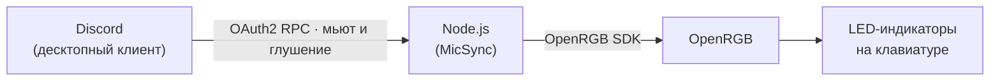

# OpenRGB ↔ Discord MicSync


**RU** | [English](README.en.md)

Приложение подсвечивает клавиатуру через **OpenRGB**, реагируя на **мьют микрофона и глушение звука в Discord**. Два LED-индикатора на клавиатуре показывают состояние голосовых настроек, чтобы вы видели мьют, не отвлекаясь от игры.



Статус читается из **Discord**, а не из системных настроек Windows: мьют в Discord подсветит индикатор независимо от того, где вы его поставили.

---

## Возможности

- Индикация мьюта микрофона и глушения звука из Discord (статус Discord, не системы)
- Веб-страница настроек: устройство, LED-индексы, цвета, автозагрузка — без правки файлов
- Режим подсветки 💡 — заставляет выбранные LED-кнопки гореть жёлтым, чтобы найти их на клавиатуре
- Автозагрузка вместе со Windows (запуск скрытым окном)
- Автопереподключение к Discord и OpenRGB с нарастающей задержкой, обновление токена
- Журнал событий на странице настроек и в файлах `logs/`

---

## Требования

| Компонент | Зачем |
|---|---|
| Windows 10/11 | Платформа запуска, автозагрузка |
| [Node.js](https://nodejs.org/) 18 или новее | Работа приложения |
| [OpenRGB](https://openrgb.org/) с включённым **SDK Server** | Управление подсветкой (по умолчанию `localhost:6742`) |
| Десктопный Discord, запущенный | Источник статуса микрофона и звука |
| Приложение в [Discord Developer Portal](https://discord.com/developers/applications) | Авторизация по OAuth2 |

---

## Быстрый старт

### 1. Установка

```bash
git clone https://github.com/Neogara/OpenRGB-Discord-MicSync.git
cd OpenRGB-Discord-MicSync
npm install
```

### 2. Приложение в Discord Developer Portal

1. Откройте [Discord Developer Portal](https://discord.com/developers/applications) → **New Application**.
2. Во вкладке **OAuth2** скопируйте **Client ID** и **Client Secret**.
3. В поле **Redirects** добавьте адрес, в точности совпадающий со строкой в `config.js`:

   ```
   http://localhost:3000
   ```

   > Порт `3000` закреплён за обратным вызовом OAuth2 и в коде не меняется. Если указать другой адрес, Discord отклонит авторизацию.

4. Создайте в корне проекта файл `secrets.env`:

   ```bash
   CLIENT_ID=ваш_client_id
   CLIENT_SECRET=ваш_client_secret
   ```

### 3. Включите SDK Server в OpenRGB

Запустите OpenRGB → **Settings** → вкладка **General** → поставьте галочку **Enable SDK Server** → **Apply**. Значения `localhost` и `6742` менять не нужно.

### 4. Первый запуск

```bash
npm start
```

При первом запуске откроется браузер для авторизации Discord. Разрешите доступ — после подключения откроется экран результата:


Нажмите **«Перейти в настройки»** — вы попадёте на страницу настроек. Адрес страницы печатается в журнал при каждом старте:

```
[WebUI] Страница настроек: http://127.0.0.1:3001
```

При следующих запусках авторизация не потребуется: приложение хранит токен и обновляет его само.

---

## Страница настроек

Страница живёт на `127.0.0.1` и открывается только на вашем компьютере. Адрес и порт печатаются в журнале; порт можно поменять на самой странице.


Страница разделена на четыре блока:

| Блок | Что настраивается |
|---|---|
| **Приложение** | Автозагрузка, открытие страницы при старте, порт страницы, адрес и порт OpenRGB |
| **Устройство OpenRGB** | Выбор устройства из списка, который OpenRGB отдаёт в реальном времени |
| **LED-кнопки** | LED-индексы микрофона и звука, цвета OFF/ON для каждого канала |
| **Журнал** | Последние события приложения с кнопкой «обновить» |

В шапке страницы — бейджи состояния:

| Бейдж | Значение |
|---|---|
| `Discord: подключён` | Приложение видит Discord и подписывается на голосовые события |
| `OpenRGB: localhost:6742` | Соединение с SDK Server установлено |
| `Микрофон: OFF` / `ON` | **OFF** — мьют активен (красный), **ON** — микрофон открыт (зелёный) |
| `Звук: OFF` / `ON` | **OFF** — звук заглушён (красный), **ON** — звук включён (зелёный) |

### Кнопка подсветки 💡

Кнопка в заголовке блока «LED-кнопки» — это тумблер. Когда он включён, выбранные LED-индексы горят жёлтым: так легко найти нужные кнопки на клавиатуре и проверить, что индексы указаны верно. Индексы можно править прямо в этом режиме — подсветка переедет на новый индекс, а предыдущий вернёт свой цвет. При выключении подсветки восстанавливается цвет, который горел до неё.

### Что применяется сразу, а что после перезапуска

| Изменение | Когда применяется |
|---|---|
| Устройство, LED-индексы, цвета, адрес и порт OpenRGB | Сразу после нажатия «Сохранить и применить» |
| Автозагрузка, открытие страницы при старте | Сразу |
| Порт страницы настроек | После перезапуска приложения |

---

## Конфигурация

Приложение разделяет настройки на три уровня:

| Уровень | Файл | Назначение |
|---|---|---|
| Пользовательские настройки | `settings.json` | Устройство, LED-индексы, цвета, порты, автозагрузка. Создаётся и редактируется на странице настроек |
| Константы инфраструктуры | `config.js` | Реквизиты OAuth2, адрес обратного вызова, файл токена. Правится только при смене приложения в Developer Portal |
| Переменные окружения | `secrets.env` | `CLIENT_ID` и `CLIENT_SECRET`. Имеют приоритет над остальными источниками |

`settings.json` создаётся автоматически при первом сохранении настроек. Пока файла нет, используются значения по умолчанию из `settings.js`:

| Параметр | По умолчанию |
|---|---|
| `device.keyboardDeviceId` | `1` |
| `device.micLedIndex` | `15` |
| `device.soundLedIndex` | `14` |
| `colors.micMuted` (OFF) | `#00FF00` — зелёный |
| `colors.micUnmuted` (ON) | `#FF0000` — красный |
| `colors.soundDeaf` (OFF) | `#00FF00` — зелёный |
| `colors.soundUndeaf` (ON) | `#FF0000` — красный |
| `openrgb.host` / `openrgb.port` | `localhost` / `6742` |
| `webui.port` / `webui.openOnStart` | `3001` / `false` |
| `autostart` | `false` |

Цвета OFF/ON для LED-индикаторов настраиваются отдельно от цветов бейджей в шапке страницы.

### Переменные окружения

| Переменная | Назначение |
|---|---|
| `CLIENT_ID`, `CLIENT_SECRET` | Реквизиты OAuth2 (обычно из `secrets.env`) |
| `DISCORD_PIPE` | Имя пайпа Discord, например `discord-ipc-5` для Canary. Пусто — автоматический перебор `discord-ipc-0..9` |
| `OPENRGB_HOST`, `OPENRGB_PORT` | Переопределяют адрес OpenRGB (нужны для тестов и нестандартных запусков) |

---

## Устранение неполадок

Журнал доступен на странице настроек в блоке **«Журнал»** и в файлах `logs/app-<дата>.log`. Файл ротируется при достижении 5 МБ.

| Симптом | Вероятная причина | Что делать |
|---|---|---|
| `Discord: нет (…)`, бейдж не меняется | Discord не запущен или авторизация не пройдена | Запустите Discord. Если токен истёк или удалён — перезапустите приложение: браузер откроет авторизацию заново |
| Discord работает в Canary/PTR | Другой пайп IPC | Задайте `DISCORD_PIPE` (например `discord-ipc-5`) |
| `OpenRGB: не подключён` | SDK Server выключен или другой порт | Включите **Enable SDK Server** в OpenRGB и сверьте адрес/порт на странице настроек |
| Не горят нужные кнопки | Неверный LED-индекс | Включите 💡 и подбирайте индекс, пока кнопка не загорится жёлтым |
| Страница настроек не открывается | Порт занят другим приложением | Порт указан в журнале при старте. Задайте другой в блоке «Приложение» и перезапустите приложение |
| Авторизация завершается ошибкой | Redirect в Developer Portal не совпадает | В поле **Redirects** должен стоять `http://localhost:3000` — без `127.0.0.1` и без завершающего слэша |
| Настройки сбрасываются | В `settings.json` некорректные значения | Значения откатятся к дефолтам, причина попадёт в журнал. Откройте страницу настроек и сохраните их заново |

---

## Структура проекта

```
OpenRGB-Discord-MicSync/
├── main.js                Точка входа
├── config.js              Константы: OAuth2, порты, файлы
├── settings.js            Загрузка, валидация и сохранение settings.json
├── tokenManager.js        Авторизация OAuth2 и обновление токена
├── discordIpc.js          Клиент IPC Discord (именные пайпы)
├── discordRpc.js          Слой RPC: подписки на голосовые события, переподключение
├── openRGBController.js   Подключение к OpenRGB, применение цветов, подсветка
├── autostart.js           Автозагрузка Windows (.vbs в папке «Автозагрузка»)
├── logger.js              Журнал в консоль и в logs/
├── webui/
│   ├── server.js          HTTP-сервер страницы настроек и API
│   └── public/            Разметка, стили и скрипты страниц
├── docs/screenshots/      Скриншоты для этой документации
├── secrets.env            Ваши ключи Discord (создаётся вами, не сохраняется в git)
├── settings.json          Пользовательские настройки (создаётся автоматически)
├── discord_token.json     Discord-токен (создаётся при авторизации)
└── logs/                  Журналы приложения
```

`secrets.env`, `settings.json`, `discord_token.json` и `logs/` в `.gitignore` и в репозиторий не попадают.

---

## Лицензия

[ISC](https://opensource.org/license/isc-license-js)
